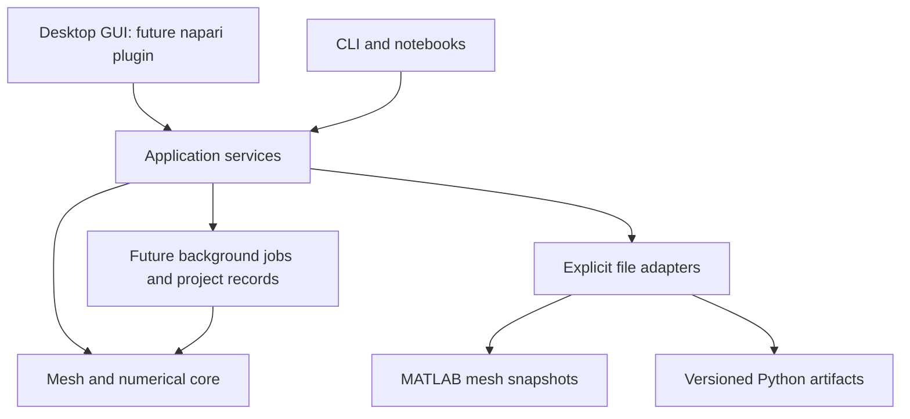

# Architecture and path to a GUI

## Scientific boundary

TubULAR's current MATLAB object combines scientific calculations, experiment
state, file naming, interactive choices, and plotting. Python should separate
these responsibilities. A scientific result must not depend on which viewer
is open, which timepoint is selected, or whether a preview was rendered.

The first release target is a reproducible workflow from existing segmented
surfaces to validated pullbacks and measurements. Raw-image segmentation can
be integrated through adapters after that workflow is reliable. The present
implementation only reaches measurements and sampling on *existing* charts.

## Implemented modules

| Module | Responsibility | Dependency boundary |
| --- | --- | --- |
| `mesh` | Validated mesh snapshots and topology checks | NumPy; SciPy only for topology |
| `geometry` | Pure per-mesh numerical operations | NumPy/SciPy, no files or viewer |
| `grid` | Rectilinear connectivity and explicit seam mapping | No implicit parameterization |
| `io` | MATLAB and NPZ adapters | Conversion happens at this boundary |
| `imaging` | Trilinear sampling and supplied-chart pullbacks | No segmentation or temporal tracking |
| `analysis` | JSON-compatible mesh inspection | Same callable for CLI and GUI |
| `cli` | Input/output and user-facing failures | Delegates calculations to core |

`Mesh` copies its arrays and marks them read-only to prevent ordinary accidental
mutation. This is an API convention, not a security boundary. New geometry is
represented by a new mesh. Computational functions return values and do not
save files or change global state. Pullback sampling accepts progress and
cancellation callbacks without importing a UI library.

## Proposed project model (not implemented)

An `Experiment` should be a versioned project manifest, not a large mutable
equivalent of the MATLAB handle class. It should reference these records:

| Record | Required information |
| --- | --- |
| Image series | Source URI, checksum, explicit `t,c,z,y,x` axis labels, dtype, channel IDs, voxel spacing, origin, physical unit |
| Timepoints | Explicit timestamp values and time unit, including nonuniform acquisition intervals |
| Coordinate frame | Raw/aligned/material frame ID, axis names, handedness, complete transform, units |
| Mesh artifact | Vertex/face arrays, correspondence ID, frame ID, topology report, checksum |
| Chart artifact | Mesh ID, per-vertex UV, units of each chart axis, periodicity, cut-to-glued index map |
| Field artifact | Scalar/vector/tensor data, sample association (face/vertex/pixel), basis, covariant/contravariant type, unit |
| Operation record | Input IDs/hashes, algorithm and version, parameters, output IDs, warnings, environment, timestamps |

Do not subtract time-adjacent vertex arrays unless correspondence is explicitly
established. Do not combine vectors from raw, aligned, and material frames
without transforming both their coordinates and bases. Do not interpret a
frame-index difference as elapsed time. APDV mirroring must be recorded because
it changes orientation-sensitive quantities.

For large volumes, evaluate chunked OME-Zarr adapters separately. Small mesh
snapshots currently use NPZ; this is not a claim that NPZ is a suitable whole
experiment format. Never serialize application objects with pickle as the
project storage format.

## GUI proposal

**Preferred first prototype: a napari plugin**, keeping all computation in the
headless package. Napari supplies image, point, vector, and surface layers and
a plugin mechanism; this is a design choice based on those capabilities, not
a validated integration in this repository. See its
[surface layer documentation](https://napari.org/stable/howtos/layers/surface.html)
and [plugin documentation](https://napari.org/stable/plugins/index.html).

The first GUI milestone should let a researcher:

1. Open a project and confirm image axes, voxel spacing, and time units.
2. Inspect the image volume and mesh together, with boundary/nonmanifold defects
   highlighted and an orientation preview.
3. Choose anterior/posterior/dorsal landmarks, inspect a centerline, and confirm
   cuts using reversible edits.
4. Inspect the unwrapped image beside the 3D surface, with linked selections
   and visible seam locations.
5. Run a validated measurement, inspect its quality report, and export both
   the result and the exact parameters used.

Implement the first two views before offering unvalidated mapping/strain
buttons. Keep unfinished operations out of the active workflow. An initial
surface-layer adapter must explicitly convert core XYZ coordinates to the
viewer's image-axis order; test a labeled asymmetric volume to catch mirrored
or transposed overlays. Per-face values cannot silently become per-vertex
colors: document any averaging used for display.

The GUI should submit immutable requests to background workers. Progress,
cancellation, errors, and result IDs return as messages. Qt objects remain on
the main thread. Results become visible only after a completed operation;
cancellation never promotes partial files to finished artifacts. Preview
parameters and committed analysis parameters must remain distinguishable.

A custom Qt/PyVista application remains an option if linked 2D/3D selection or
large-mesh performance proves inadequate in a napari prototype. That decision
should follow a real-dataset benchmark, not precede it.

## Reproducibility and execution (future work)

Each stage should declare inputs and outputs explicitly and operate on one
timepoint or a specified interval. Cache keys must include content hashes,
parameters, coordinate conventions, and algorithm version, not just a filename.
Write into a temporary artifact directory and atomically promote the completed
record; journal failures/cancellations. Handle migrations explicitly when a
manifest schema changes. The current NPZ writer only prevents overwrite; it
does not yet implement this transactional experiment store.

Parallelize independent timepoints only after single-process parity is stable.
Establish memory/runtime baselines on one representative midgut or heart
dataset before choosing process counts, array chunking, or a GPU backend.
No cloud service is required for the proposed desktop workflow.
